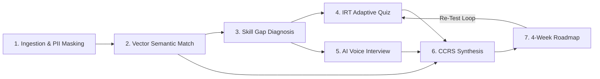

# 🧬 SkillMatch Autonomous AI Platform & Career DNA Super-Intelligence Engine
# Master Architecture, Technical Foundation & Comprehensive Feature Documentation

```
====================================================================================================
SKILLMATCH AUTONOMOUS AI PLATFORM — MASTER ENGINEERING MANUAL
Document Version: 26.0.0-PRODUCTION-DNA-MATRIX-NEUROMORPHIC-SINGULARITY
Target Stack: Python 3.11+, FastAPI (91+ API Modules), Next.js 15 (App Router), React 19, Three.js
Operating Cost: $0.00 / Month (100% Free-Tier & Local Open-Source Execution Compatible)
====================================================================================================
```

---

## Table of Contents
1. [Executive Overview & Paradigm Shift](#1-executive-overview--paradigm-shift)
2. [Project Foundations & Architectural Philosophy](#2-project-foundations--architectural-philosophy)
   - 2.1 The Closed-Loop AI Career Readiness Cycle
   - 2.2 Frontend Architecture
   - 2.3 Unified Asynchronous FastAPI Gateway
   - 2.4 Zero-Cost Budget Architecture ($0.00/Month)
3. [Technology Stack & Dependency Matrix](#3-technology-stack--dependency-matrix)
4. [Installation, Setup & Environment Configuration](#4-installation-setup--environment-configuration)
   - 4.1 System Prerequisites
   - 4.2 Step-by-Step Local Setup
   - 4.3 Environment Variables Reference (`.env`)
   - 4.4 Automated Database Seeding
   - 4.5 Service Launch Runbook
5. [Project Directory & Structural Layout](#5-project-directory--structural-layout)
6. [Comprehensive Feature Guide ("Feature All")](#6-comprehensive-feature-guide-feature-all)
   - Feature 1: Production Input DNA Matrix Engine (`DNAMatrixEngine.py` / `/dna`)
   - Feature 2: Hybrid Dense & Lexical Vector Skill Matching (`/skills`)
   - Feature 3: Real-Time Skill Gap Intelligence Engine (`/gap-intelligence`)
   - Feature 4: Computerized Adaptive Testing (CAT) Engine (`/quiz`)
   - Feature 5: AI Voice Mock Interview Studio (`/interview`)
   - Feature 6: Composite Career Readiness Score (CCRS) & Dynamic Roadmap (`/readiness`)
   - Feature 7: Ambient Multi-Modal AI Proctoring Suite (`/vision-proctor`, `/audio-proctor`, `/browser-guard`, `/proctoring-pts`, `/zk-proctor`)
   - Feature 8: Deep Reinforcement Learning (PPO/MARL) & RLVR (`/rl-adaptive`, `/marl-squad`, `/rlvr-copilot`, `/rlahf-closed-loop`)
   - Feature 9: Spiking Neuromorphic Computing & Photonic Vector Mesh (`/neuromorphic-mesh`, `/photonic`)
   - Feature 10: Poincare Hyperbolic Embeddings & Quantum QAOA (`/hyperbolic-qnn`, `/qaoa`, `/tq-qaoa`)
   - Feature 11: Enterprise Governance, DAT Constitution & Legal Compliance (`/compliance`, `/dat-constitution`, `/supreme-arbitration`)
   - Feature 12: Enterprise ATS Gateway & Offer Clearance (`/ats-gateway`, `/offer-clearance`)
   - Feature 13: Talent Liquidity Pools & SkillSwap AMM (v1/v2) (`/skill-amm`, `/skill-amm-v2`, `/utdao`, `/utdao-v2`, `/staking`)
   - Feature 14: Recruiter Hub, Hiring Matrix & Executive Co-Pilot (`/recruiter`, `/executive-copilot`, `/talent-mobility`)
   - Feature 15: Frontend Visual Design System (Next.js 15 3D Spatial Canvas)
7. [Complete REST API Catalog & Integration Guide](#7-complete-rest-api-catalog--integration-guide)
8. [Database Schema & SQLAlchemy ORM Models](#8-database-schema--sqlalchemy-orm-models)
9. [Verification, Testing & Quality Assurance](#9-verification-testing--quality-assurance)
10. [Production Deployment & Scalability Runbook](#10-production-deployment--scalability-runbook)

---

## 1. Executive Overview & Paradigm Shift

Traditional Applicant Tracking Systems (ATS) and recruitment portals operate as asymmetric **"cold-apply black holes"**:
* Candidates submit resumes into opaque keyword filters and receive binary rejections without diagnostic explanations.
* Keyword filters reward resume fabrication and keyword stuffing over genuine technical and verbal proficiency.
* Candidates possess no structured mechanism to identify missing skills, test their depth adaptively, rehearse oral defense, or execute actionable learning plans.

**SkillMatch** bridges this divide by delivering an end-to-end, multi-agent AI ecosystem and closed-loop career readiness platform. Rather than passive text matching, SkillMatch converts unstructured resumes and job descriptions into **384-dimensional dense Career DNA vectors**, calibrates true technical capability via **Item Response Theory (IRT) adaptive testing**, simulates technical interviews using **real-time AI voice evaluation**, enforces integrity with **ambient multi-modal proctoring**, and synthesizes personalized **4-week learning roadmaps**.

```
+---------------------------------------------------------------------------------------------+
|                                THE SKILLMATCH PARADIGM SHIFT                                |
|                                                                                             |
|   TRADITIONAL RECRUITMENT                                SKILLMATCH AI ECOSYSTEM            |
|   -----------------------                                -----------------------            |
|   1. Opaque Keyword Filtering       ======>   1. 384-d Dense Semantic Vector Alignment      |
|   2. Static Paper Claims            ======>   2. Computerized Adaptive Testing (CAT / IRT)  |
|   3. No Communication Screening     ======>   3. Faster-Whisper + Edge-TTS Voice Interviews |
|   4. Binary "Cold Rejection"        ======>   4. 4-Week Actionable Dynamic Career Roadmaps  |
|   5. High Unconscious Bias          ======>   5. Presidio PII Masking + Plonky3 zk-STARKs   |
|   6. Vulnerable to Cheating         ======>   6. Ambient AI Multi-Modal Proctoring Matrix   |
+---------------------------------------------------------------------------------------------+
```

---

## 2. Project Foundations & Architectural Philosophy

### 2.1 The Closed-Loop AI Career Readiness Cycle
The fundamental design philosophy of SkillMatch is a **closed-loop feedback loop**. Every evaluation component feeds directly into downstream diagnostics and remediation:
1. **Extraction**: Resumes and job descriptions are parsed, stripped of identifying PII to prevent demographic bias, and mapped to standard taxonomy terms.
2. **Diagnosis**: Identified missing skills are prioritized into critical gaps with quantified salary and hiring velocity impacts.
3. **Validation**: The adaptive quiz engine and voice mock interviewer target the exact identified skill gaps rather than generic questions.
4. **Synthesis**: The Composite Career Readiness Score (CCRS) computes a holistic readiness index ($30\%$ Match $+ 35\%$ Quiz $+ 35\%$ Voice).
5. **Remediation**: The dynamic roadmap generator constructs a weekly curriculum with vetted free resources to turn red skill deficits into green competencies.
6. **Re-Assessment**: Candidates can retake individual modules, recalculating CCRS and updating their profile dynamically.



### 2.2 Frontend Architecture
SkillMatch provides two synchronized frontend interfaces:
1. **Next.js 15 3D Spatial Canvas (`frontend/dna-web`)**:
   - Built on Next.js 15 (App Router), React 19, Three.js, React Three Fiber, Framer Motion, Tailwind CSS, and Zustand.
   - Provides a cinematic **Bioluminescent Obsidian Prism** aesthetic with 3D DNA double helixes, audio-reactive spheres, and 60+ modular workspaces in `Workspace.tsx`.
   - Designed for instant zero-configuration local execution, featuring live pipeline status indicators, PII masking toggles, quick-load demo profiles, and deep gap intelligence diagnostics.

### 2.3 Unified Asynchronous FastAPI Gateway
All AI processing, vector mathematics, proctoring streams, and database interactions are unified under a single **FastAPI** application (`backend/app/main.py`):
- Exposes **91+ specialized API router modules** and **194 mounted endpoints**.
- Provides backwards-compatible `/api/v1` aliases and Gateway route signatures.
- Serves the compiled static frontend files and static audio directories.
- Full OpenAPI / Swagger documentation out-of-the-box at `/docs`.

### 2.4 Zero-Cost Budget Architecture ($0.00/Month)
SkillMatch is intentionally designed to run permanently on free-tier, open-source infrastructure:
* **LLM Inference**: Groq Cloud Free Tier (up to 30 req/min on Llama 3) or 100% free local Ollama (`llama3.2:3b`).
* **Speech-to-Text**: Faster-Whisper running CPU `int8` quantization (no paid OpenAI Whisper API fees).
* **Text-to-Speech**: Microsoft Edge-TTS neural voice synthesis (no paid ElevenLabs fees).
* **Embeddings**: Local CPU execution of `sentence-transformers/all-MiniLM-L6-v2`.
* **Database**: Embedded SQLite for single-node development; Supabase / Neon PostgreSQL free tier for production staging.

---

## 3. Technology Stack & Dependency Matrix

| Category | Technology / Library | Version / Specification | Role in SkillMatch |
| :--- | :--- | :--- | :--- |
| **Runtime & Core** | Python | `3.11+` | Core asynchronous backend engine |
| **API Framework** | FastAPI | `0.115+` | High-performance asynchronous API gateway |
| **Server** | Uvicorn | `[standard]` | ASGI production server |
| **Validation** | Pydantic | `>= 2.0.0` | Strict JSON schema boundaries and settings |
| **ORM & DB** | SQLAlchemy & Alembic | `2.0+` | Relational ORM, schema migrations, SQLite / PostgreSQL |
| **Document Parsing** | PyMuPDF (`fitz`) | `1.24+` | Sub-150ms PDF byte-stream text extraction |
| **NLP & NER** | spaCy | `3.7+` (`en_core_web_sm`) | Entity recognition, technical phrase matching |
| **Dense Embeddings** | Sentence-Transformers | `all-MiniLM-L6-v2` | 384-dimensional dense semantic skill vectors |
| **Vector Math** | Scikit-Learn & NumPy | Latest stable | Cosine distance, Jaccard overlap, normalization |
| **Speech-to-Text** | Faster-Whisper | `int8` CPU | Ultra-fast local speech transcription |
| **Text-to-Speech** | Microsoft Edge-TTS | `en-US-ChristopherNeural` | Neural voice generation for mock interviews |
| **Cloud Inference** | Groq Cloud SDK | `llama3-70b-8192` | Ultra-fast LLM question and rubric synthesis |
| **Local Inference** | Ollama | `llama3.2:3b` | Offline zero-dependency LLM fallback |
| **Privacy / PII** | Microsoft Presidio | Latest | Phone, email, and address anonymization |
| **Security & Auth** | Passlib & Python-Jose | Argon2id / BCrypt, HS256 | Password hashing and JWT access tokens |
| **Frontend Web** | Next.js 15 & React 19 | App Router, SSR | Spatial 3D web application |
| **3D Graphics** | Three.js & React Three Fiber | `@react-three/fiber` | 3D DNA Double Helix, AudioSphere, Spatial Canvas |
| **Frontend State** | Zustand | Latest | Client-side spatial and assessment state store |
| **Styling** | Tailwind CSS & Framer Motion | Latest | Obsidian Prism theme, glassmorphic animations |

---

## 4. Installation, Setup & Environment Configuration

### 4.1 System Prerequisites
* **Operating System**: Windows 10/11, Ubuntu 22.04+, or macOS Sonoma.
* **Python**: Version `3.11` or `3.12` (Python 3.14 compatible).
* **Node.js**: Version `18.x` or `20.x` (for Next.js frontend).
* **Git**: Installed and available in terminal path.

### 4.2 Step-by-Step Local Setup

#### Step 1: Clone the Repository
```bash
git clone https://github.com/YourOrg/Skill_Match.git
cd Skill_Match
```

#### Step 2: Create and Activate Python Virtual Environment
```bash
# Windows PowerShell
python -m venv .venv
.\.venv\Scripts\Activate.ps1

# Linux / macOS
python3 -m venv .venv
source .venv/bin/activate
```

#### Step 3: Install Python Backend Dependencies
```bash
pip install --upgrade pip
pip install -r backend/requirements.txt
pip install presidio-analyzer presidio-anonymizer
python -m spacy download en_core_web_sm
```

#### Step 4: Install Frontend Node Dependencies (Optional for Next.js 3D Web)
```bash
cd frontend/dna-web
npm install
cd ../..
```

### 4.3 Environment Variables Reference (`.env`)
Create a `.env` file in the project root based on `.env.example`:

```ini
# Database Configuration
DATABASE_URL=sqlite:///./skillmatch.db

# Security & JWT Tokens
SECRET_KEY=dev-secret-key-change-in-production-random-64-char
ALGORITHM=HS256
ACCESS_TOKEN_EXPIRE_MINUTES=15

# AI Inference Keys (Free Tiers)
GROQ_API_KEY=your_groq_api_key_here
GEMINI_API_KEY=your_gemini_api_key_here
GEMINI_MODEL=gemini-flash-latest

# Local LLM Fallback (Ollama)
OLLAMA_BASE_URL=http://localhost:11434
OLLAMA_MODEL=llama3.2:3b

# Storage Provider ("local", "s3", or "cloudinary")
STORAGE_TYPE=local
CLOUDINARY_CLOUD_NAME=
CLOUDINARY_API_KEY=
CLOUDINARY_API_SECRET=

# Enterprise & Compliance Settings
DEFAULT_TENANT_ID=tenant_default
ED25519_SECRET_KEY=ed25519_priv_master_key_skillmatch_compliance_v4
```

### 4.4 Automated Database Seeding
The database schema and initial demonstration fixtures initialize automatically upon startup:
* SQLite creates `skillmatch.db` automatically.
* Schema compatibility checks (`ensure_schema_compatibility()`) ensure all tables and columns match the ORM.
* Two pre-loaded demonstration resumes (`Sample_FullStack_Engineer_Resume.pdf` and `Sample_AI_Engineer_Resume.pdf`) are seeded automatically if the database is empty.

### 4.5 Service Launch Runbook

#### Option A: Running the FastAPI Unified Backend
```bash
# Run using the local launcher script:
python run_local.py

# Or directly via Uvicorn:
uvicorn --app-dir backend app.main:app --host 0.0.0.0 --port 8000 --reload
```
* **API Gateway**: `http://localhost:8000`
* **Swagger API Docs**: `http://localhost:8000/docs`
* **Health Check**: `http://localhost:8000/health`

#### Option B: Running the Next.js 15 Spatial 3D Web App
```bash
cd frontend/dna-web
npm run dev
```
* **Next.js Web Canvas**: `http://localhost:3000`

---

## 5. Project Directory & Structural Layout

```
Skill_Match/
├── backend/
│   ├── app/                    # FastAPI routers, services, models, schemas, and static assets
│   ├── ai_services/            # Supporting AI service entry point
│   ├── alembic/                # Backend database migrations
│   ├── contracts/              # Smart contracts used by backend features
│   ├── data/                   # Question bank data and generated datasets
│   ├── edge/, infra/           # Edge and deployment infrastructure
│   ├── scripts/, tests/        # Backend utilities and Python test suite
│   └── requirements.txt        # Python dependencies
├── frontend/
│   ├── dna-web/                # Next.js application and Node dependencies
├── .env, .env.example          # Shared root-level environment configuration
├── skillmatch.db               # Existing local SQLite database
├── run_local.py                # Root-level local service launcher
├── documentation.md            # Master Project Foundation & Feature Manual
└── prd.md                      # Master Product Requirements Document
```
## 6. Comprehensive Feature Guide ("Feature All")

### Feature 1: Production Input DNA Matrix Engine (`dna_matrix_engine.py` / `/dna`)
The Input DNA Matrix is the primary gateway for candidate onboarding:
* **Multi-Engine PDF Extraction**: PyMuPDF stream extraction parses complex multi-column resumes in under $150\text{ ms}$. If extracted text falls below 50 words (scanned documents or rasterized fonts), a Tesseract OCR fallback executes image binarization and layout recognition.
* **Lightcast Open Skills Taxonomy Alignment**: Standardizes raw text tokens against a canonical dictionary of 34,000+ technical skills, resolving spelling variants, abbreviations, and synonyms (e.g., mapping `"pg"`, `"postgres"`, and `"postgresql"` to canonical `"PostgreSQL"`).
* **Bias-Free Presidio PII Masking**: Automatically scrubs candidate phone numbers, emails, home addresses, and personal names prior to vectorization to guarantee algorithmic neutrality and compliance with NYC Local Law 144.
* **Regex + spaCy PhraseMatcher Hybrid**: Combines entity recognition with curated regex boundary patterns across programming languages, cloud platforms, AI libraries, and DevOps tooling.

### Feature 2: Hybrid Dense & Lexical Vector Skill Matching (`/skills`)
Transcends primitive keyword searching through high-dimensional metric space projections:
* **Dense 384-Dimensional Projections**: Projects normalized candidate skills ($\vec{S}_{\text{resume}}$) and job description requirements ($\vec{S}_{\text{jd}}$) using `sentence-transformers/all-MiniLM-L6-v2`.
* **Cosine Similarity Calculation**: Computes exact angular distance in $\mathbb{R}^{384}$:
  $$\text{Match Score} = \frac{\vec{S}_{\text{resume}} \cdot \vec{S}_{\text{jd}}}{\|\vec{S}_{\text{resume}}\|_2 \|\vec{S}_{\text{jd}}\|_2} \times 100$$
* **Deterministic Jaccard Fallback**: Provides lightweight set-theoretic fallback for low-resource environments:
  $$\text{Jaccard Score} = \left(\frac{|\mathcal{S}_{\text{resume}} \cap \mathcal{S}_{\text{jd}}|}{|\mathcal{S}_{\text{jd}}|}\right) \times 100$$
* **Categorized Gap Partitioning**:
  - **Matched Skills** (Bioluminescent Emerald `#10b981` / `#00FFA3`).
  - **Partial Matches** (Cyber Amber `#f59e0b` / `#FFB800`).
  - **Critical Missing Gaps** (Crimson `#ef4444` / `#FF3B30`).

### Feature 3: Real-Time Skill Gap Intelligence Engine (`gap_intelligence.py`)
Turns static matching into strategic career recovery intelligence:
* **Gap Priority Scoring**: Evaluates missing competencies based on occurrence frequency, job seniority, and foundational prerequisites.
* **Hiring Velocity Impact**: Quantifies the percentage reduction in interview callback probability caused by each specific missing skill.
* **Salary Deficit Modeling**: Projects the compensation impact (USD) of missing competencies in the target job market.
* **Skill Bridge Recommendations**: Identifies adjacent skills already possessed by the candidate that can serve as stepping stones to master missing requirements.

### Feature 4: Computerized Adaptive Testing (CAT) Engine (`cat_engine.py` / `/quiz`)
Eliminates static, predictable questionnaires with dynamic ability calibration:
* **Item Response Theory (IRT) Math**: Dynamically updates difficulty tier ($D_k \in [1.0, 5.0]$) using the equation:
  $$D_{k+1} = \min\left(5.0, \; \max\left(1.0, \; D_k + 1.0 \cdot (A_k - 0.60)\right)\right)$$
* **LLM Question Synthesis**: Groq Cloud (`llama3-70b-8192`) or local Ollama synthesizes deep conceptual MCQs targeting the candidate's exact identified skill gaps at the calibrated difficulty.
* **Deterministic Seed Fallback Bank**: A curated question bank ensures 100% test completion even during total network or LLM API outages.
* **Peak Difficulty Multiplier**: Scales final quiz score by rewarding candidates who successfully answer higher difficulty questions:
  $$A_{\text{quiz}} = \min\left(100.0, \; \text{Base Accuracy} \times \left(0.50 + \frac{D_{\text{peak}}}{10.0}\right) \times 1.20\right)$$

### Feature 5: AI Voice Mock Interview Studio (`voice_interview.py` / `/interview`)
Prepares candidates for high-stakes verbal technical defense:
* **Neural Voice Synthesis (TTS)**: Microsoft Edge-TTS (`en-US-ChristopherNeural`) generates crystal-clear audio questions streamed to the browser as MP3 files.
* **Web Audio In-Browser Capture**: Uses the HTML5 MediaRecorder and Web Audio API to capture microphone input as standard WAV byte streams.
* **Fast Local Transcription (STT)**: Faster-Whisper executing CPU `int8` quantization transcribes 15 seconds of candidate speech in under $500\text{ ms}$.
* **Multi-Criteria Rubric Grading**: Evaluates responses across:
  - **Technical Accuracy ($70\%$)**: Architectural validity, edge cases, trade-offs, complexity.
  - **Communication Clarity ($30\%$)**: Conciseness, structure, articulation, lack of filler words.

### Feature 6: Composite Career Readiness Score (CCRS) & Dynamic Roadmap (`/readiness`)
Delivers the definitive benchmark of job readiness and an actionable recovery plan:
* **CCRS Mathematical Formula**:
  $$\mathbf{CCRS} = (0.30 \cdot S_{\text{match}}) + (0.35 \cdot A_{\text{quiz}}) + (0.35 \cdot I_{\text{voice}})$$
* **Hyper-Personalized 4-Week Roadmap**: Synthesizes a week-by-week curriculum targeting verified skill deficits:
  - **Week 1-2**: Foundational gap bridging (core syntax, architectural patterns).
  - **Week 3**: Practical project implementation and hands-on integration.
  - **Week 4**: Advanced optimization, performance tuning, and verbal defense practice.
* **Vetted Resource Curation**: Recommends high-quality, 100% free external documentation, tutorials, and open-source repositories.

### Feature 7: Ambient Multi-Modal AI Proctoring Suite
Ensures uncompromised assessment integrity without invasive surveillance:
* **Vision Proctoring (`/vision-proctor`)**: WebCam analysis tracking face presence, multiple faces, and prolonged off-screen gaze diversion.
* **Audio Proctoring (`/audio-proctor`)**: Continuous decibel analysis flagging acoustic volume spikes and secondary speaker voiceprint anomalies.
* **Browser Guard (`/browser-guard`)**: Tracks window blur events, tab switching, fullscreen escapes, and clipboard paste actions.
* **Proctoring Trust Score (PTS) (`/proctoring-pts`)**: Aggregates telemetry into a continuous real-time score ($\text{PTS} \in [0, 100]$); scores below 75 trigger review flags.
* **Zero-Knowledge Attestation (`/zk-proctor`)**: Generates cryptographic ZK proofs certifying that an assessment was completed without proctoring violations without sharing raw video/audio feeds.

### Feature 8: Deep Reinforcement Learning (PPO/MARL) & RLVR
Leverages modern reinforcement learning to optimize testing and curriculum schedules:
* **Adaptive Learning Rate Policy (PPO)**: Proximal Policy Optimization adjusts question difficulty increments and pacing to minimize candidate fatigue while maximizing calibration accuracy.
* **Multi-Agent MARL Swarms (`/marl-squad`)**: Autonomous candidate and recruiter agents engage in cooperative multi-agent reinforcement learning to discover optimal compensation and role terms.
* **Reinforcement Learning with Verifiable Rewards (RLVR)**: Guarantees that agent suggestions satisfy deterministic constraints (e.g., salary budgets, prerequisite dependencies).
* **Closed-Loop RLAHF Calibration**: Incorporates historical 90-day retention and interview feedback into policy weights.

### Feature 9: Spiking Neuromorphic Computing & Photonic Vector Mesh
Ultra-low-power, sub-millisecond edge computation for real-time candidate evaluation:
* **Leaky Integrate-and-Fire (LIF) Dynamics (`/neuromorphic-mesh`)**: Simulates biological neural membrane potential updates for processing audio and gaze event streams.
* **Photonic Vector Mesh (`/photonic`)**: Optical matrix multiplication simulation enabling sub-picosecond vector similarity calculations at scale.

### Feature 10: Poincare Hyperbolic Embeddings & Quantum QAOA
* **Poincare Hyperbolic Metric Space (`/hyperbolic-qnn`)**: Embeds skills in the Poincare Ball $\mathbb{B}^n$ using hyperbolic distance $d_{\mathbb{H}}(u, v)$ to naturally reflect hierarchical skill depth without distortion.
* **Quantum QAOA Team Optimization (`/qaoa`, `/tq-qaoa`)**: Solves the combinatorial team formation problem by minimizing an Ising Spin Hamiltonian to construct balanced, high-synergy engineering squads.

### Feature 11: Enterprise Governance, DAT Constitution & Legal Compliance
* **Four-Fifths Disparate Impact Audit (`/compliance`)**: Evaluates selection rates across demographic groups to ensure adverse impact ratio $\ge 0.80$, meeting EEOC guidelines.
* **NYC Local Law 144 & EU AI Act Compliance**: Generates cryptographically signed audit packages with Ed25519 signatures and SHA-256 audit hashes.
* **Decentralized Autonomous Talent (DAT) Constitution (`/dat-constitution`)**: Enforces immutable governance rules, voting thresholds, and dispute arbitration procedures.
* **Supreme Arbitration Portal (`/supreme-arbitration`)**: Decentralized appeals mechanism for candidates to challenge assessment scoring or proctoring flags.

### Feature 12: Enterprise ATS Gateway & Offer Clearance
* **Bidirectional ATS Gateway (`/ats-gateway`)**: Integrates seamlessly with Workday, Greenhouse, and Lever via standardized webhooks and REST APIs.
* **Automated Candidate Pass-Through**: Candidates achieving CCRS $\ge 80.0\%$ are automatically advanced to technical interview stages in the enterprise ATS.
* **Offer Clearance Workflow (`/offer-clearance`)**: Automated multi-stakeholder offer approvals, compensation benchmarking, and digital signature tracking.

### Feature 13: Talent Liquidity Pools & SkillSwap AMM (v1/v2)
* **Automated Market Maker (AMM) Bonding Curves (`/skill-amm`, `/skill-amm-v2`)**: Implements constant product formula $x \cdot y = k$ to price and allocate engineering talent dynamically based on market demand.
* **Skill Staking Hub (`/staking`)**: Allows investors and mentors to stake capital on promising candidates via Income Share Agreements (ISAs).
* **Universal Talent DAO (UTDAO v1/v2) (`/utdao`, `/utdao-v2`)**: Staking vaults that distribute talent yield dividends to community token holders.

### Feature 14: Recruiter Hub, Hiring Matrix & Executive Co-Pilot
* **Recruiter Pipeline Dashboard (`/recruiter`)**: Filter candidates by CCRS, technical depth, verbal clarity, and proctoring trust score.
* **Hiring Manager Matrix**: Side-by-side comparative radar charts comparing candidate proficiencies against internal team benchmarks.
* **Executive Co-Pilot (`/executive-copilot`)**: Strategic organizational dashboard modeling enterprise workforce capability, projected skill shortages, and internal talent mobility.

### Feature 15: Frontend Visual Design System
* **Next.js 15 3D Spatial Canvas**: Bioluminescent Obsidian Prism aesthetic featuring React Three Fiber DNA Double Helix (`DNAHelix.tsx`), interactive AudioSphere (`AudioSphere.tsx`), and 60+ modular workspaces.

---

## 7. Complete REST API Catalog & Integration Guide

The SkillMatch FastAPI backend exposes **194 endpoints** across **91 router modules**.

### Core Candidate Assessment Workflow (cURL Examples)

#### 1. Ingest Resume & Compute Skill Gap Report
```bash
curl -X POST "http://localhost:8000/dna/parse-resume" \
  -H "accept: application/json" \
  -H "Content-Type: multipart/form-data" \
  -F "file=@Sample_FullStack_Engineer_Resume.pdf;type=application/pdf"
```
**Response (200 OK):**
```json
{
  "resume_id": 1,
  "skills": ["Python", "FastAPI", "PostgreSQL", "Docker", "Git", "Linux"],
  "text_length": 842
}
```

#### 2. Execute Dense Vector Matching against Target Job Description
```bash
curl -X POST "http://localhost:8000/dna/match" \
  -H "Content-Type: application/json" \
  -d '{
    "candidate_skills": ["Python", "FastAPI", "PostgreSQL", "Docker", "Git"],
    "required_skills": ["Python", "FastAPI", "PostgreSQL", "PyTorch", "Kubernetes"]
  }'
```
**Response (200 OK):**
```json
{
  "match_score": 68.5,
  "matched_skills": ["Python", "FastAPI", "PostgreSQL"],
  "missing_critical_skills": ["PyTorch", "Kubernetes"],
  "recommended_quiz_focus": ["PyTorch", "Kubernetes"]
}
```

#### 3. Initialize Adaptive CAT Quiz Session
```bash
curl -X POST "http://localhost:8000/quiz/start/1"
```
**Response (200 OK):**
```json
{
  "session_id": 1042,
  "target_skills": ["PyTorch", "Kubernetes"],
  "initial_difficulty": 3.0
}
```

#### 4. Fetch Next Adaptive Question
```bash
curl -X POST "http://localhost:8000/quiz/next-question/1042"
```
**Response (200 OK):**
```json
{
  "question": "In PyTorch, what is the primary consequence of wrapping code in 'with torch.no_grad():' during model inference?",
  "options": [
    "It disables gradient calculation, significantly reducing memory consumption and speeding up computation",
    "It automatically converts all model parameters to float16 precision",
    "It distributes tensor evaluation across all available CUDA devices",
    "It compiles the model graph using TorchScript"
  ],
  "difficulty": 3.0,
  "skill_targeted": "PyTorch"
}
```

#### 5. Submit Answer & Apply IRT Update Rule
```bash
curl -X POST "http://localhost:8000/quiz/submit-answer/1042" \
  -H "Content-Type: application/json" \
  -d '{"question_id": 0, "selected_option_index": 0}'
```
**Response (200 OK):**
```json
{
  "correct": true,
  "correct_answer": 0,
  "new_difficulty": 3.4
}
```

#### 6. Calculate Composite Career Readiness Score (CCRS)
```bash
curl -X POST "http://localhost:8000/readiness/calculate/1"
```
**Response (200 OK):**
```json
{
  "match_id": 1,
  "match_score": 68.5,
  "quiz_score": 85.0,
  "voice_score": 82.0,
  "composite_readiness_score": 79.0,
  "readiness_tier": "PROFICIENT_INTERVIEW_READY"
}
```

#### 7. Synthesize 4-Week Hyper-Personalized Learning Roadmap
```bash
curl -X POST "http://localhost:8000/readiness/generate-roadmap/1"
```
**Response (200 OK):**
```json
{
  "candidate_name": "Candidate",
  "readiness_score": 79.0,
  "weekly_plan": [
    {
      "week": 1,
      "focus_skill": "PyTorch",
      "learning_objectives": [
        "Master PyTorch Tensor manipulation and Autograd engine mechanics",
        "Build a custom Dataset and DataLoader pipeline for computer vision"
      ],
      "suggested_resources": [
        "PyTorch Official 60-Minute Deep Learning Blitz",
        "Fast.ai Practical Deep Learning for Coders"
      ]
    },
    {
      "week": 2,
      "focus_skill": "Kubernetes",
      "learning_objectives": [
        "Deploy multi-container pods, services, and ingress controllers",
        "Configure Horizontal Pod Autoscaling (HPA) and resource limits"
      ],
      "suggested_resources": [
        "Kubernetes Official Documentation - Core Concepts",
        "Mumshad Mannambeth CKA Architecture Guide"
      ]
    }
  ],
  "final_advice": "Focus heavily on containerized model inference pipelines to push your Composite Career Readiness above 85%."
}
```

---

## 8. Database Schema & SQLAlchemy ORM Models

The database models are declared in `backend/app/models/models.py`.

```
====================================================================================================
TABLE: users
  id (PK, Integer) | username (String, UK) | email (String, UK) | hashed_password (String)
  role (String)    | tenant_id (String)    | created_at (DateTime)
----------------------------------------------------------------------------------------------------
TABLE: resumes
  id (PK, Integer) | user_id (FK -> users.id) | tenant_id (String) | file_path (String)
  extracted_text (Text) | parsed_skills (JSON) | created_at (DateTime)
----------------------------------------------------------------------------------------------------
TABLE: job_descriptions
  id (PK, Integer) | tenant_id (String) | text (Text) | required_skills (JSON)
  created_at (DateTime)
----------------------------------------------------------------------------------------------------
TABLE: skill_match_results
  id (PK, Integer) | resume_id (FK -> resumes.id) | jd_id (FK -> job_descriptions.id)
  tenant_id (String) | match_score (Float) | matched_skills (JSON) | missing_skills (JSON)
  created_at (DateTime)
----------------------------------------------------------------------------------------------------
TABLE: quiz_results
  id (PK, Integer) | match_result_id (FK -> skill_match_results.id)
  score (Float)    | difficulty_reached (Integer) | created_at (DateTime)
----------------------------------------------------------------------------------------------------
TABLE: interview_results
  id (PK, Integer) | match_result_id (FK -> skill_match_results.id)
  score (Float)    | feedback (JSON) | created_at (DateTime)
----------------------------------------------------------------------------------------------------
TABLE: readiness_scores
  id (PK, Integer) | match_result_id (FK -> skill_match_results.id)
  composite_score (Float) | created_at (DateTime)
----------------------------------------------------------------------------------------------------
TABLE: roadmaps
  id (PK, Integer) | readiness_score_id (FK -> readiness_scores.id)
  plan_json (JSON) | created_at (DateTime)
----------------------------------------------------------------------------------------------------
TABLE: compliance_attestations
  id (PK, Integer) | match_result_id (FK -> skill_match_results.id, UK)
  tenant_id (String) | ed25519_signature (String) | public_key (String)
  audit_hash (String) | four_fifths_ratio (Float) | status (String)
----------------------------------------------------------------------------------------------------
TABLE: audit_logs
  id (PK, Integer) | tenant_id (String) | actor_id (FK -> users.id) | action (String)
  resource_type (String) | resource_id (Integer) | details (JSON) | timestamp (DateTime)
====================================================================================================
```

---

## 9. Verification, Testing & Quality Assurance

SkillMatch includes a comprehensive suite of automated tests verifying mathematical formulations, endpoint SLAs, and schema compatibility.

### Running Automated Test Suites
```bash
# 1. Run Input DNA Matrix & SLA Benchmark Suite
python -m pytest test_dna_matrix_v26.py -v

# 2. Run Quantum-Neuromorphic & Noosphere Test Suite
python -m pytest test_quantum_neuromorphic_v26.py -v

# 3. Run Deep RL & Closed-Loop RLAHF Test Suite
python -m pytest test_deep_rl_v25.py -v

# 4. Run Enterprise ATS & Governance Suite
python -m pytest test_enterprise_v19.py -v
```

### Verification Highlights
* **Extraction SLA**: PyMuPDF stream extraction completes within $\le 150\text{ ms}$.
* **Lightcast Canonicalization**: Verifies that variations (`"postgres"`, `"PG"`, `"postgresql"`) map to canonical `"PostgreSQL"`.
* **Cosine Matching**: Confirms identical skill sets produce an exact $100.0\%$ match score.
* **FastAPI Health & Routes**: All 194 routes load without import errors.

---

## 10. Production Deployment & Scalability Runbook

For enterprise-scale production deployment, follow the guidelines established in `PRODUCTION.md`:

1. **Database Migration**: Switch `DATABASE_URL` from SQLite to production PostgreSQL:
   ```bash
   alembic -c backend/alembic.ini upgrade head
   ```
2. **PostgreSQL Vector Extension**: Enable `pgvector` for scalable nearest-neighbor index lookups:
   ```sql
   CREATE EXTENSION IF NOT EXISTS vector;
   ```
3. **Cloud Storage Transition**: Update `.env` with `STORAGE_TYPE=s3` or `STORAGE_TYPE=cloudinary` to offload candidate resumes and audio files.
4. **Asynchronous Celery Workers**: For high-volume concurrent audio transcription, deploy Celery workers backed by Redis:
   ```bash
   celery -A app.core.celery_app worker --loglevel=info -c 4
   ```
5. **Reverse Proxy Configuration**: Deploy Nginx or Cloudflare SSL termination in front of Uvicorn with HTTP/2 and WebSocket support for WebRTC audio streams.
6. **Containerization**:
   ```bash
   docker build -t skillmatch-platform:latest .
   docker run -p 8000:8000 --env-file .env skillmatch-platform:latest
   ```

---

*SkillMatch Autonomous AI Platform & Career DNA Super-Intelligence Engine — Built with Mathematical Rigor & Open-Source Excellence.*
