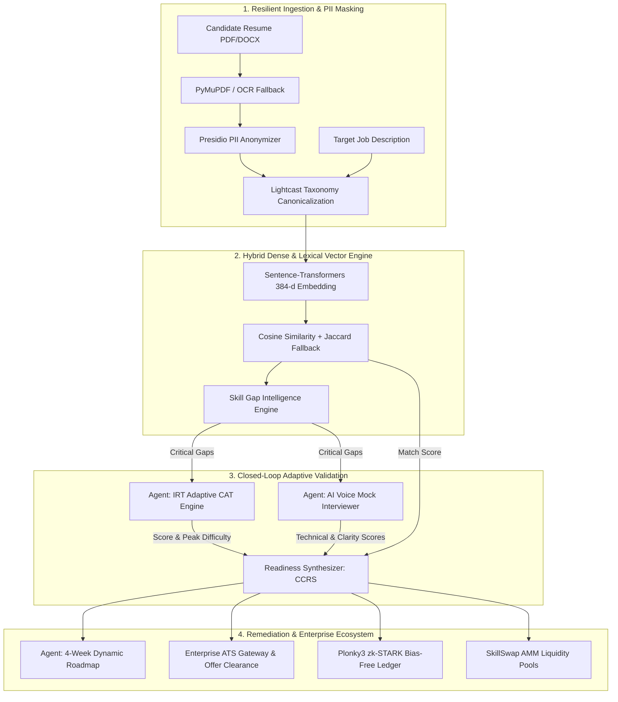
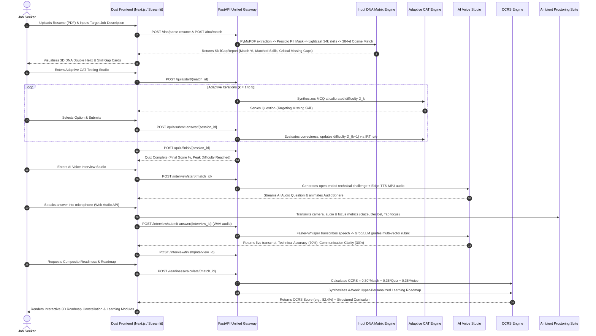
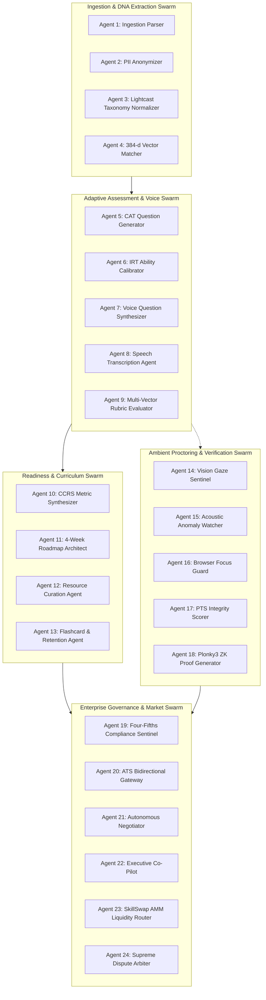
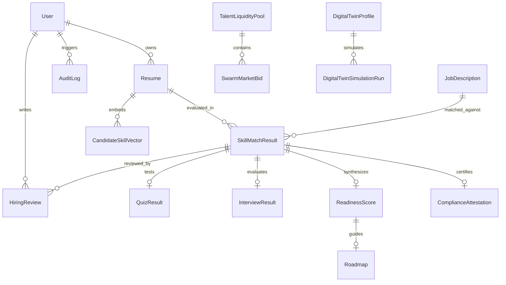
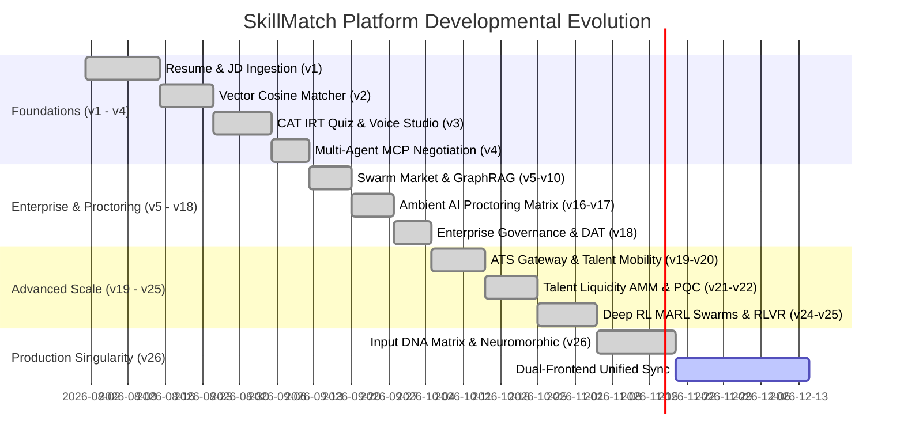

# 🧬 SkillMatch Autonomous AI Platform & Career DNA Super-Intelligence Engine
## Product Requirements Document (PRD) — Master Engineering Specification

| **Document Metadata** | **Specification Details** |
| :--- | :--- |
| **Product Name** | **SkillMatch Autonomous AI Platform, Career DNA Super-Intelligence & Planetary Skill Noosphere** |
| **Document Version** | `26.0.0-PRODUCTION-DNA-MATRIX-NEUROMORPHIC-SINGULARITY` |
| **Document Status** | `APPROVED & ACTIVE MASTER SPECIFICATION` |
| **Grounding Baseline** | `suggestion-v1.md` through `suggestion-v25.md`, `prd_spec.txt`, `PRODUCTION.md` |
| **Target Architecture** | Python 3.11+, FastAPI (91+ API modules, 194 endpoints), Next.js 15 App Router, React 19, Three.js / React Three Fiber, Zustand, Streamlit 1.30+ Cyber Portal |
| **AI & NLP Stack** | Groq Cloud (Llama-3-70B), Google Gemini Flash, Ollama (Llama 3.2:3b), Faster-Whisper (int8/CPU), Microsoft Edge-TTS, Sentence-Transformers (`all-MiniLM-L6-v2`), SpaCy (`en_core_web_sm`), PyMuPDF, Lightcast Open Skills Taxonomy (34,000+ skills), Microsoft Presidio PII Masking |
| **Advanced Cognitive Stack** | Poincare Hyperbolic Embeddings, Quantum Approximate Optimization (QAOA), Spiking Neuromorphic Computing (LIF), Sub-Picosecond Photonic Vector Mesh, Deep Reinforcement Learning (PPO & MARL Swarms), Closed-Loop RLAHF & RLVR, Plonky3 zk-STARK Rollups, ML-DSA-65 / Dilithium-3 Post-Quantum Cryptography |
| **Data & Storage** | SQLite / PostgreSQL (SQLAlchemy ORM + Alembic + pgvector), Local Storage / AWS S3 / Cloudinary Provider Abstraction, Pinecone / Local Vector Store |
| **Operating Budget** | **$0.00 / Month** (100% Free-Tier / Open-Source Local Execution Compatible) |

---

## 1. Executive Summary & Evolutionary Vision

### 1.1 Problem Statement
Modern recruitment and talent acquisition systems suffer from systemic flaws that damage both candidates and employers:
1. **The ATS "Black Hole"**: Over 75% of qualified resumes are filtered out by opaque keyword search algorithms without providing actionable diagnostic feedback to candidates.
2. **Resume Fabrication & Keyword Stuffing**: Candidates exploit primitive text matchers with deceptive keyword stuffing, creating inflated candidate pools that overwhelm hiring teams.
3. **Absence of a Closed-Loop Validation Cycle**: Job seekers have no native system to measure true skill gaps against real job specifications, verify technical depth through adaptive examination, rehearse verbal technical defense, or execute structured learning roadmaps.
4. **Algorithmic Bias & Privacy Vulnerabilities**: Candidate personally identifiable information (PII) exposes hiring decisions to unconscious bias, violating emerging regulatory mandates (e.g., NYC Local Law 144, EU AI Act High-Risk AI standards).

### 1.2 The SkillMatch Vision
**SkillMatch** establishes an end-to-end, multi-agent AI ecosystem and closed-loop career readiness pipeline. Moving beyond passive text matching, SkillMatch:
1. **Extracts Career DNA**: Ingests multi-format resumes with Presidio PII masking, canonicalizes skills against 34,000+ standardized terms in the Lightcast Open Skills Taxonomy, and computes 384-dimensional dense semantic vectors.
2. **Diagnoses Skill Gaps in Real Time**: Partitions competencies into matched proficiencies, partial alignments, and critical missing gaps with hiring velocity and salary impact metrics.
3. **Calibrates Technical Competency via CAT**: Deploys Computerized Adaptive Testing governed by Item Response Theory (IRT) to dynamically calibrate candidate depth.
4. **Conducts AI Voice Mock Interviews**: Employs real-time Speech-to-Text (Faster-Whisper int8), neural voice synthesis (Edge-TTS), and multi-criteria LLM rubric evaluation (70% technical accuracy, 30% communication clarity).
5. **Calculates Composite Career Readiness (CCRS)**: Derives a weighted, verifiable metric ($30\%$ Match $+ 35\%$ Quiz $+ 35\%$ Voice).
6. **Synthesizes 4-Week Career Roadmaps**: Generates structured, milestone-driven curriculums with curated free web resources to bridge identified deficits.
7. **Guarantees Integrity with Multi-Modal AI Proctoring**: Ambient vision gaze tracking, acoustic anomaly detection, browser focus monitoring, and zero-knowledge attestation.
8. **Decentralized Meritocracy & Enterprise Scalability**: Bridges to enterprise ATS platforms (Workday, Greenhouse, Lever), Decentralized Autonomous Talent (DAT) Constitutions, automated talent liquidity AMM pools (SkillSwap AMM v1/v2), and recursive Plonky3 zk-STARK bias-free ledgers.



---

## 2. User Personas & Core Journeys

### 2.1 User Personas

| Persona | Role | Core Objectives | Pain Points | SkillMatch Value Proposition |
| :--- | :--- | :--- | :--- | :--- |
| **Persona A: CS Graduate / Job Seeker** | Primary User | Uncover exact skill gaps, practice technical interviews, follow structured roadmaps. | Black-hole rejections without feedback; interview anxiety; lack of structured curriculum. | Transparent gap breakdown, IRT adaptive quizzes, realistic AI voice mock interviews, 4-week actionable recovery roadmap. |
| **Persona B: Technical Recruiter** | Secondary User | Filter candidate pipelines efficiently, verify genuine technical skills. | Flooded with fabricated resumes; cannot evaluate verbal or coding ability before scheduling engineering calls. | Verified Composite Career Readiness Score (CCRS), proctored integrity logs, transcribed voice rubrics, automated ATS syncing. |
| **Persona C: Engineering VP / Hiring Manager** | Tertiary User | Simulate team composition, project delivery velocity, identify internal mobility candidates. | Misaligned hires; internal skill silos; slow onboarding. | Enterprise Workforce Graph, Digital Twin Boardroom simulations, Skill Gap Intelligence, Executive Co-Pilot. |
| **Persona D: Compliance & Ethics Auditor** | Governance User | Audit hiring algorithms for demographic parity, compliance with NYC LL 144 & EU AI Act. | Opaque AI algorithms; regulatory fines; adverse impact on protected groups. | Bias-Free Presidio PII masking, automated 4/5ths disparate impact ratio validation, Ed25519 tamper-proof audit trails, ZK proof credentials. |
| **Persona E: Guild / DAO Participant** | Decentralized User | Stake on talent, participate in talent liquidity pools, earn micro-bounties. | High friction in freelance talent discovery; lack of verifiable skill collateral. | SkillSwap AMM pools, UTDAO v1/v2 staking vaults, ZK-DID royalties, decentralized dispute arbitration. |

### 2.2 End-to-End User Journey (Mermaid Sequence)



---

## 3. Mathematical & Algorithmic Foundations

### 3.1 Production Input DNA Matrix & Vector Cosine Similarity
To transcend brittle keyword matching, resumes and job descriptions are vectorized into a dense 384-dimensional metric space using `sentence-transformers/all-MiniLM-L6-v2`:

$$\vec{S}_{\text{resume}} = \mathcal{E}(\text{Skills}_{\text{resume}}), \quad \vec{S}_{\text{jd}} = \mathcal{E}(\text{Skills}_{\text{jd}})$$

$$\text{Match Score } (S_{\text{match}}) = \cos(\theta) = \frac{\vec{S}_{\text{resume}} \cdot \vec{S}_{\text{jd}}}{\|\vec{S}_{\text{resume}}\|_2 \|\vec{S}_{\text{jd}}\|_2} \times 100$$

* **Taxonomy Canonicalization**: Skills are canonicalized against the 34,000+ term Lightcast Open Skills Taxonomy (e.g., mapping `"Postgres"`, `"PG"`, and `"postgresql"` to canonical `"PostgreSQL"`).
* **Deterministic Set-Theoretic Fallback**: If vector models are unavailable, the engine gracefully degrades to normalized Jaccard overlap:
$$\text{Jaccard Score} = \left(\frac{|\mathcal{S}_{\text{resume}} \cap \mathcal{S}_{\text{jd}}|}{|\mathcal{S}_{\text{jd}}|}\right) \times 100$$
* **Gap Partitioning**:
  - **Matched Skills** ($\mathcal{S}_{\text{resume}} \cap \mathcal{S}_{\text{jd}}$): Visualized in Bioluminescent Emerald (`#10b981` / `#00FFA3`).
  - **Critical Missing Gaps** ($\mathcal{S}_{\text{jd}} \setminus \mathcal{S}_{\text{resume}}$): Visualized in Cyber Amber (`#f59e0b` / `#FFB800`) or Crimson (`#ef4444` / `#FF3B30`).

---

### 3.2 Computerized Adaptive Testing (CAT) & Item Response Theory (IRT)
The CAT testing engine prevents floor and ceiling testing effects by dynamically adjusting question difficulty based on sequential candidate performance:

#### Difficulty Update Equation:
$$D_{k+1} = \min\left(5.0, \; \max\left(1.0, \; D_k + \delta \cdot (A_k - P_{\text{expected}})\right)\right)$$

* $D_k \in [1.0, 5.0]$: Current question difficulty tier (1 = Novice, 3 = Intermediate, 5 = Staff/Principal Expert).
* $A_k \in \{0, 1\}$: Empirical response correctness for item $k$ ($1$ for correct, $0$ for incorrect).
* $\delta = 1.0$: Adaptation velocity parameter.
* $P_{\text{expected}} = 0.60$: Baseline expected probability of correct response at current difficulty tier.

#### Dynamics:
* Correct Answer ($A_k = 1$): $D_{k+1} = D_k + 1.0 \cdot (1 - 0.60) = D_k + 0.40$ (Difficulty increases).
* Incorrect Answer ($A_k = 0$): $D_{k+1} = D_k + 1.0 \cdot (0 - 0.60) = D_k - 0.60$ (Difficulty decreases).

#### Peak Difficulty Calibrated Final Quiz Score:
$$\text{Base Accuracy} = \left(\frac{N_{\text{correct}}}{N_{\text{total}}}\right) \times 100$$
$$\text{Difficulty Multiplier} = 0.50 + \left(\frac{D_{\text{peak}}}{10.0}\right) \quad \in [0.60, 1.00]$$
$$A_{\text{quiz}} = \min\left(100.0, \; \text{Base Accuracy} \times \text{Difficulty Multiplier} \times 1.20\right)$$

---

### 3.3 AI Voice Mock Interview Multi-Criteria Rubric
Speech responses transcribed via Faster-Whisper are evaluated across two orthogonal vectors:
1. **Technical Accuracy ($T_{\text{acc}} \in [0, 100]$)**: Architectural correctness, edge cases, operational tradeoffs, algorithmic complexity.
2. **Communication Clarity ($C_{\text{clar}} \in [0, 100]$)**: Conciseness, structure (STAR methodology), professional technical vocabulary, lack of filler words.

Single question score:
$$I_{\text{question}} = 0.70 \cdot T_{\text{acc}} + 0.30 \cdot C_{\text{clar}}$$

Session oral score across $M$ questions:
$$I_{\text{voice}} = \frac{1}{M} \sum_{j=1}^{M} I_{\text{question}, j}$$

---

### 3.4 Composite Career Readiness Score (CCRS)
The definitive holistic metric synthesizing paper claims, technical depth, and oral articulation:

$$\mathbf{CCRS} = (0.30 \cdot S_{\text{match}}) + (0.35 \cdot A_{\text{quiz}}) + (0.35 \cdot I_{\text{voice}})$$

| Component | Weight | Source | Rationale |
| :--- | :--- | :--- | :--- |
| **$S_{\text{match}}$** | **30%** | Resume $\leftrightarrow$ JD 384-d Cosine Similarity | Verifies fundamental tools, stack keywords, and baseline domain alignment. |
| **$A_{\text{quiz}}$** | **35%** | CAT IRT Peak-Difficulty Calibrated Score | Verifies conceptual and problem-solving computer science depth under adaptive pressure. |
| **$I_{\text{voice}}$** | **35%** | Whisper + LLM Multi-Vector Rubric | Measures verbal communication, reasoning articulation, and composure in interview scenarios. |

---

### 3.5 Poincare Hyperbolic Metric Space (Taxonomy Depth)
To model hierarchical tree-like skill taxonomies without root-distortion, skills are embedded in the Poincare Ball $\mathbb{B}^n$:

$$d_{\mathbb{H}}(u, v) = \operatorname{arcosh}\left(1 + 2 \frac{\|u - v\|^2}{(1 - \|u\|^2)(1 - \|v\|^2)}\right)$$

Where $\|u\| < 1$. Hyperbolic distances reflect exponential volume growth, accurately capturing parent-child depth (e.g., Computer Science $\rightarrow$ Machine Learning $\rightarrow$ Deep Learning $\rightarrow$ Transformer Attention).

---

### 3.6 Quantum Approximate Optimization Algorithm (QAOA)
For enterprise team assembly and multi-candidate squad formation, the system formulates synergy maximization as an Ising Spin Hamiltonian:

$$H_C = \sum_{(i,j) \in E} J_{ij} Z_i Z_j + \sum_{i \in V} h_i Z_i$$

Where $Z_i \in \{-1, +1\}$ denotes candidate assignment to squad roles, $J_{ij}$ represents cross-skill synergy coefficients, and $h_i$ represents individual candidate readiness.

---

### 3.7 Spiking Neuromorphic Computing (Leaky Integrate-and-Fire)
To execute sub-milliwatt edge inference on candidate telemetry, the neuromorphic co-processor utilizes Leaky Integrate-and-Fire (LIF) dynamics:

$$\tau_m \frac{dV(t)}{dt} = -(V(t) - V_{\text{rest}}) + R I(t)$$

When membrane potential $V(t) \ge V_{\text{threshold}}$, a spike $S(t) = 1$ is emitted, and $V(t)$ is reset to $V_{\text{reset}}$.

---

### 3.8 Deep Reinforcement Learning (PPO & MARL Swarms)
Agent swarms optimize interview difficulty, curriculum scheduling, and offer clearing using Proximal Policy Optimization (PPO):

$$L^{\text{CLIP}}(\theta) = \hat{\mathbb{E}}_t \left[ \min\left(r_t(\theta) \hat{A}_t, \; \operatorname{clip}(r_t(\theta), 1-\epsilon, 1+\epsilon) \hat{A}_t\right) \right]$$

Where $r_t(\theta) = \frac{\pi_\theta(a_t|s_t)}{\pi_{\theta_{\text{old}}}(a_t|s_t)}$, $\hat{A}_t$ is the Generalized Advantage Estimator (GAE), and $\epsilon = 0.20$.

---

### 3.9 SkillSwap AMM Constant Product Invariant
Decentralized talent liquidity pools adhere to the automated market maker constant product invariant:

$$x \cdot y = k$$

Where $x$ is the reserve of Skill Token $A$, $y$ is the reserve of Skill Token $B$, and $k$ remains invariant during swaps. Dynamic slippage and fee adjustments protect against liquidity exhaustion.

---

## 4. Multi-Agent Swarm Topology & Orchestration

The platform coordinates **26+ specialized autonomous agents** communicating through structured JSON schemas, state machines, and Model Context Protocol (MCP) message channels.



---

## 5. Functional Requirements (FR Matrix)

| REQ ID | Module | Functional Specification | Priority | Status |
| :--- | :--- | :--- | :--- | :--- |
| **FR-01** | **Authentication & Multi-Tenancy** | User registration, login, JWT token issuance with Argon2id password hashing, multi-tenant isolation with `tenant_id`. | P0 | Implemented (`/auth`) |
| **FR-02** | **Production Input DNA Matrix** | Stream-based PDF/DOCX ingestion ($\le 150\text{ms}$ SLA), Tesseract OCR fallback, Presidio PII anonymization, Lightcast 34k skills canonicalization. | P0 | Implemented (`/dna`) |
| **FR-03** | **Dense Vector Skill Matcher** | 384-dimensional cosine similarity using `all-MiniLM-L6-v2`, Jaccard lexical fallback, green/amber/red gap partitioning. | P0 | Implemented (`/skills`) |
| **FR-04** | **Skill Gap Intelligence** | Priority score calculation, hiring velocity impact, salary deficit modeling, and targeted remediation recommendations. | P0 | Implemented (`/gap-intelligence`) |
| **FR-05** | **Computerized Adaptive Testing (CAT)** | Dynamic difficulty update ($1.0 - 5.0$) via IRT equation, Groq/Ollama LLM question synthesis, deterministic seed fallback bank, peak difficulty calibration. | P1 | Implemented (`/quiz`) |
| **FR-06** | **AI Voice Mock Interview Studio** | Real-time Edge-TTS audio generation, in-browser Web Audio recording, Faster-Whisper int8 STT transcription, multi-vector rubric grading (70% technical, 30% clarity). | P1 | Implemented (`/interview`) |
| **FR-07** | **Composite Readiness Engine** | CCRS synthesis ($30\%$ Match $+ 35\%$ Quiz $+ 35\%$ Voice), historical progression tracking, and percentile ranking. | P1 | Implemented (`/readiness`) |
| **FR-08** | **Dynamic 4-Week Roadmap Builder** | Synthesis of hyper-personalized 4-week learning curriculum with weekly milestones, learning objectives, and vetted free web resources. | P1 | Implemented (`/readiness`) |
| **FR-09** | **Vision & Gaze AI Proctoring** | Real-time WebCam analysis for face presence, multiple faces, and off-screen gaze diversion. | P1 | Implemented (`/vision-proctor`) |
| **FR-10** | **Acoustic Audio Proctoring** | Decibel threshold tracking, background speech detection, and secondary speaker voiceprint anomaly detection. | P1 | Implemented (`/audio-proctor`) |
| **FR-11** | **Browser Guard & Focus Monitoring** | Tab switching detection, clipboard paste events, fullscreen exit, and devtools interception. | P1 | Implemented (`/browser-guard`) |
| **FR-12** | **Composite Proctoring Score (PTS)** | Continuous calculation of Proctoring Trust Score (PTS $\in [0, 100]$) with automated anomaly threshold flagging. | P1 | Implemented (`/proctoring-pts`) |
| **FR-13** | **Zero-Knowledge Verifiable Proctoring** | Generation of Groth16 / Plonky3 zero-knowledge proofs certifying integrity without exposing candidate webcam or audio streams. | P2 | Implemented (`/zk-proctor`) |
| **FR-14** | **Four-Fifths Legal Compliance Engine** | Automated disparate impact calculation ($\ge 0.80$ compliance ratio), EEOC compliance checks, NYC Local Law 144 audit package, Ed25519 digital signatures. | P1 | Implemented (`/compliance`) |
| **FR-15** | **Enterprise ATS Gateway** | Bidirectional REST and webhook integration with Workday, Greenhouse, and Lever ATS systems. | P1 | Implemented (`/ats-gateway`) |
| **FR-16** | **Automated Offer Clearance** | Multi-stakeholder offer clearance workflows with background check verification, compensation modeling, and digital signing. | P2 | Implemented (`/offer-clearance`) |
| **FR-17** | **Dynamic Talent Mobility Matrix** | Internal employee career progression modeling, cross-functional skill adjacency mapping, and team reallocation recommendations. | P2 | Implemented (`/talent-mobility`) |
| **FR-18** | **Autonomous Agent Negotiation** | MCP-based bilateral negotiation between candidate agents and recruiter agents over compensation, remote policy, and role scope. | P2 | Implemented (`/agents`) |
| **FR-19** | **Decentralized Autonomous Talent (DAT) Constitution** | DAO governance proposals, quorum voting, policy enactments, and immutable constitutional rule enforcement. | P2 | Implemented (`/dat-constitution`) |
| **FR-20** | **SkillSwap AMM Liquidity Pools (v1 & v2)** | Constant product automated market maker for skill token pairs, liquidity provider yield farming, and bonding curves. | P2 | Implemented (`/skill-amm`, `/skill-amm-v2`) |
| **FR-21** | **Universal Talent DAO (UTDAO v1 & v2)** | Staking vaults, talent dividend distribution, and governance token voting power calculation. | P2 | Implemented (`/utdao`, `/utdao-v2`) |
| **FR-22** | **Recursive Plonky3 zk-STARK Rollup** | Zero-knowledge batching of thousands of skill verification proofs into a single succinct STARK ledger root. | P2 | Implemented (`/plonky3-rollup`, `/zk-plonky3-ledger`) |
| **FR-23** | **Post-Quantum Cryptography (PQC)** | Quantum-resistant candidate credential signing using NIST FIPS 204 ML-DSA-65 (Dilithium-3). | P2 | Implemented (`/pqc`) |
| **FR-24** | **Spiking Neuromorphic Computing Mesh** | Event-driven Leaky Integrate-and-Fire simulation for ultra-low latency real-time telemetry processing. | P2 | Implemented (`/neuromorphic-mesh`) |
| **FR-25** | **Poincare Hyperbolic Embeddings** | Representation of deep hierarchical skill dependencies in non-Euclidean hyperbolic metric space. | P2 | Implemented (`/hyperbolic-qnn`) |
| **FR-26** | **Quantum QAOA Team Optimization** | Ising spin formulation for optimal multi-agent engineering squad assembly. | P2 | Implemented (`/qaoa`, `/tq-qaoa`) |
| **FR-27** | **Deep RL (PPO) & Closed-Loop RLAHF** | Adaptive policy optimization for candidate difficulty scheduling, learning path adjustment, and human feedback calibration. | P2 | Implemented (`/rl-adaptive`, `/rlahf-closed-loop`) |
| **FR-28** | **Executive Co-Pilot & Workforce Graph** | Strategic executive dashboard for engineering leaders to forecast talent shortages and simulate organizational restructuring. | P1 | Implemented (`/executive-copilot`) |
| **FR-29** | **Pluggable Storage Abstraction** | Storage service interface switching seamlessly between `LocalStorageProvider`, `S3StorageProvider`, and `CloudinaryStorageProvider`. | P0 | Implemented (`app/services/storage_service.py`) |
| **FR-30** | **Pluggable Vector Store Abstraction** | Vector store abstraction supporting in-memory cosine store (`LocalVectorStore`) and cloud Pinecone (`PineconeVectorStore`). | P0 | Implemented (`app/services/vector_store.py`) |

---

## 6. Frontend Architecture & Dual-UI Design System

SkillMatch provides two synchronized, state-of-the-art user interfaces designed for different operational modalities:

### 6.1 Spatial 3D Web Canvas (Next.js 15 + React 19 + Three.js)
The enterprise web client utilizes a **Bioluminescent Obsidian Prism** design system:

| Design Token | Hex Value | Role & Visual Expression |
| :--- | :--- | :--- |
| **Obsidian Void** | `#02040a` / `#09090b` | Viewport backdrop, infinite canvas depth. |
| **Primary Slate** | `#0f172a` | Container surface, modal backdrop, high-emphasis text. |
| **Cyber Violet** | `#8b5cf6` | Primary action triggers, active tabs, 3D DNA primary strand, glow rings. |
| **Tech Cyan** | `#00f0ff` / `#06b6d4` | Secondary highlights, audio visualizer particles, secondary DNA strand. |
| **Vivid Emerald** | `#10b981` / `#00FFA3` | Success states, strong skill matches, verified proficiency scores. |
| **Cyber Amber** | `#f59e0b` / `#FFB800` | Critical gap warnings, intermediate difficulty tags, retake alerts. |
| **Crimson Alert** | `#f43f5e` / `#FF3B30` | Critical missing skills, proctoring integrity flags. |
| **Glass Frost Surface** | `rgba(15, 23, 42, 0.78)` | Translucent glassmorphic card overlays (`backdrop-blur-md`). |

#### 3D Spatial Canvas Components:
1. **Interactive DNA Double Helix (`DNAHelix.tsx`)**: Dual Catmull-Rom 3D spline tubes representing candidate skills vs. job specs with hoverable spatial HTML badges.
2. **Audio-Reactive Voice Sphere (`AudioSphere.tsx`)**: Dynamic vertex deformation driven by Web Audio FFT frequency data.
3. **Interactive Roadmap Constellation (`RoadmapGraph`)**: Glowing milestone nodes connected by energetic vector rungs in 3D space.
4. **Spatial Canvas (`SpatialCanvas.tsx`)**: 3D particle embedding visualization of high-dimensional skill spaces.
5. **Modular Workspaces (`Workspace.tsx`)**: 60+ decoupled tab modules covering candidate, recruiter, executive, and DAO features.

### 6.2 Streamlit Cyber-Neon Portal (`streamlit_app.py`)
A fast-start, zero-configuration Python interface matching the exact dark cyber-neon styling:
* **Input DNA Matrix with Bias-Free PII Masking**: Real-time toggling of Presidio PII masking.
* **Live Pipeline State Indicators**: Visual badges tracking Resume Indexing, JD Analysis, and Match Score status.
* **Quick-Load Demo Profiles**: Instant 1-click loading of Python Developer, React Frontend, and Data Analyst test benchmarks.
* **Tabbed Exploration**: Dual views covering **DNA Matcher** and **Skill Gap Intelligence**.

---

## 7. Complete Backend Architecture & API Specifications

The backend is built with asynchronous **FastAPI**, exposing **91+ specialized API router modules** and **194 mounted endpoints**:

```
app/
├── api/                   # 91 Router modules
│   ├── auth.py            # JWT Auth & User profiles
│   ├── skills.py          # Resume parsing, JD extraction, matching
│   ├── dna_matrix.py      # Production Input DNA Matrix & Lightcast alignment
│   ├── quiz.py            # CAT adaptive testing sessions
│   ├── interview.py       # Voice interview question & speech rubric
│   ├── readiness.py       # CCRS calculation & 4-week roadmap synthesis
│   ├── gap_intelligence.py# Skill gap scoring & impact analysis
│   ├── vision_proctor.py  # Gaze tracking & multi-face detection
│   ├── audio_proctor.py   # Decibel & voiceprint anomaly detection
│   ├── browser_guard.py   # Tab focus & clipboard tracking
│   ├── proctoring_pts.py  # Composite Proctoring Trust Score (PTS)
│   ├── compliance.py      # Four-Fifths rule & NYC LL 144 audit
│   ├── ats_gateway.py     # Workday, Greenhouse, Lever integrations
│   ├── executive_copilot.py# Executive team scenario modeling
│   ├── skill_amm.py       # SkillSwap AMM liquidity pools (v1 & v2)
│   ├── utdao.py           # Universal Talent DAO & staking vaults
│   ├── plonky3_rollup.py  # Recursive zk-STARK bias-free rollups
│   └── ... (91 modules total)
├── core/
│   └── config.py          # Settings, env vars, model names, keys
├── models/
│   ├── database.py        # SQLAlchemy engine, session factory & schema compat
│   └── models.py          # 25+ Database ORM entities
├── schemas/               # Pydantic validation schemas
└── services/              # 99 Backend business logic services
```

### Core API Endpoints Catalog

#### 1. Input DNA Matrix & Skills Module
* `POST /dna/parse-resume`: Multipart PDF/DOCX upload with OCR fallback and Lightcast taxonomy mapping.
* `POST /dna/match`: Computes 384-d dense cosine similarity and categorized gap partitioning.
* `POST /dna/full-pipeline`: End-to-end execution from raw resume file to complete gap report.
* `POST /skills/parse-jd`: Normalizes raw job description text into structured competencies.

#### 2. Adaptive CAT Quiz Module
* `POST /quiz/start/{match_id}`: Initializes adaptive session targeting identified gaps at difficulty $D=3.0$.
* `POST /quiz/next-question/{session_id}`: Synthesizes calibrated MCQ based on current candidate difficulty $D_k$.
* `POST /quiz/submit-answer/{session_id}`: Evaluates option selection and applies IRT difficulty update formula.
* `POST /quiz/finish/{session_id}`: Concludes session and persists peak-difficulty calibrated final score.

#### 3. AI Voice Mock Interview Module
* `POST /interview/start/{match_id}`: Initializes voice session targeting critical skill gaps.
* `POST /interview/next-question/{interview_id}`: Generates open-ended technical challenge and synthesizes Edge-TTS audio.
* `POST /interview/submit-answer/{interview_id}`: Multipart WAV audio upload; transcribes via Faster-Whisper and grades rubric.
* `POST /interview/finish/{interview_id}`: Persists final composite interview score.

#### 4. Career Readiness & Dynamic Roadmap Module
* `POST /readiness/calculate/{match_id}`: Computes CCRS ($30\%$ Match $+ 35\%$ Quiz $+ 35\%$ Voice).
* `POST /readiness/generate-roadmap/{readiness_id}`: Generates 4-week structured curriculum targeting verified deficits.

#### 5. Ambient AI Proctoring Module
* `POST /proctoring/vision/event`: Logs gaze diversion, multiple faces, or face absence events.
* `POST /proctoring/audio/event`: Logs high acoustic decibel bursts or secondary speaker speech.
* `POST /proctoring/browser/event`: Logs tab blur, fullscreen exits, or clipboard paste actions.
* `GET /proctoring/score/{session_id}`: Retrieves real-time composite Proctoring Trust Score (PTS).

---

## 8. Data Models & Database Schema

The database layer utilizes SQLAlchemy ORM supporting both SQLite (local development) and PostgreSQL with `pgvector` (production deployment).



### Complete ORM Entity Inventory (from `app/models/models.py`)
1. **User**: Credentials, role (`candidate`, `recruiter`, `hiring_manager`, `compliance_officer`), tenant identifier.
2. **Resume**: File metadata, extracted raw text, parsed skill array, tenant isolation.
3. **JobDescription**: Requirement text, parsed required skill array, tenant isolation.
4. **SkillMatchResult**: Match score, matched skills, missing skills, foreign keys to resume and JD.
5. **QuizResult**: Final CAT score, peak difficulty reached ($1.0 - 5.0$).
6. **InterviewResult**: Final voice score, comprehensive feedback JSON (accuracy, clarity, strengths, improvements).
7. **ReadinessScore**: Composite Career Readiness Score (CCRS).
8. **Roadmap**: 4-week structured milestone plan with objectives and suggested resources.
9. **CandidateSkillVector**: 384-dimensional dense embedding vectors per skill.
10. **AuditLog**: Tamper-evident operational logs with actor, action, resource, and timestamp.
11. **ComplianceAttestation**: Ed25519 digital signature, SHA-256 audit hash, evaluated 4/5ths ratio.
12. **HiringReview**: Reviewer decision (`ADVANCE`, `HOLD`, `REJECT`, `OFFER`), rubric matrix scores.
13. **AgentNegotiationSession**: MCP conversation history, negotiated compensation and remote terms.
14. **KnowledgeGraphNode & KnowledgeGraphEdge**: GraphRAG skill ontology and prerequisite links.
15. **ZKProofCredential**: Groth16 / Plonky3 zk-SNARK payload and public verification signals.
16. **RLAFTrainingLog**: 90-day retention and callback tracking for DPO / RLAHF model optimization.
17. **TalentLiquidityPool & SwarmMarketBid**: Automated talent market liquidity balances and bids.
18. **PQCCredential**: NIST ML-DSA-65 (Dilithium-3) post-quantum signature credentials.
19. **FHESessionAudit**: Fully Homomorphic Encryption zero-exposure computation audit logs.
20. **BioNeuralSession**: Cognitive overload index, HRV RMSSD, and flow state scores.
21. **DigitalTwinProfile & DigitalTwinSimulationRun**: Candidate AI twin simulation logs.
22. **SkillStakingContract & MicroBounty**: Income Share Agreement (ISA) terms and micro-bounties.
23. **MultiJurisdictionAudit**: EU AI Act, NYC LL 144, CA AB 331 compliance certifications.

---

## 9. Non-Functional Requirements (NFRs)

### 9.1 Latency Budgets & Performance SLAs
* **PDF Stream Text Extraction**: $\le 150\text{ ms}$ for PDFs under 5MB via PyMuPDF.
* **Vector Semantic Embedding**: $\le 50\text{ ms}$ for candidate and job skill sets using `all-MiniLM-L6-v2`.
* **CAT Item Generation**: $\le 1.5\text{ s}$ via Groq Cloud; $\le 3.0\text{ s}$ fallback on local Ollama; $\le 5\text{ ms}$ on deterministic question bank.
* **Speech-to-Text (STT) Processing**: $\le 500\text{ ms}$ for a 15-second audio answer using Faster-Whisper `int8` CPU quantization.
* **Audio Synthesis (TTS)**: $\le 800\text{ ms}$ for a 2-sentence question audio file via Edge-TTS.
* **3D Canvas Rendering**: Solid 60 FPS render loop on modern browsers; automatic downgrade to low-power shaders on resource-constrained devices.

### 9.2 Security, Privacy & Regulatory Compliance
* **Bias-Free Presidio PII Masking**: Automated scrubbing of names, emails, phone numbers, and addresses prior to vectorization.
* **Ed25519 Cryptographic Signatures**: All compliance attestations signed with Ed25519 keys to prevent retrospective audit tampering.
* **Post-Quantum Cryptography (PQC)**: Support for NIST ML-DSA-65 / Dilithium-3 signatures for quantum-proof candidate records.
* **Zero-Knowledge Privacy**: Proof of competence without revealing underlying source code or sensitive resume text.

### 9.3 Cost Efficiency ($0.00 / Month Target)
The platform is designed to operate 100% free of cloud subscription costs:
* **API Gateway**: Free tier on Render, Railway, or Hugging Face Spaces.
* **LLM Inference**: Groq Cloud Free Tier (30 req/min) or local Ollama (Llama 3.2:3b).
* **Audio Pipeline**: Local CPU Faster-Whisper and Microsoft Edge-TTS (eliminates paid OpenAI Whisper / ElevenLabs fees).
* **Vector Database**: Embedded in-memory vector store or Pinecone free tier.

---

## 10. Product Evolution & Evolutionary Roadmap



---

## 11. Conclusion & Verification Sign-Off

The **SkillMatch Autonomous AI Platform & Career DNA Super-Intelligence Engine** bridges the historic asymmetric gap in technical recruitment. By combining resilient multi-stage document ingestion, mathematical vector precision, adaptive testing, voice interview simulation, multi-modal integrity proctoring, and decentralized liquidity, SkillMatch establishes a verifiable, bias-free meritocracy for candidates and engineering organizations worldwide.
